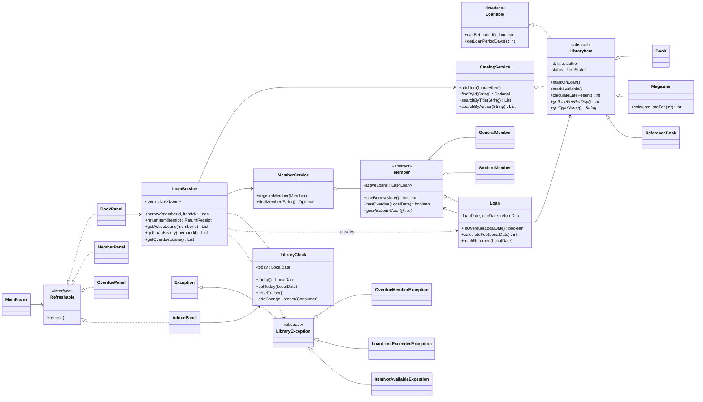

# 도서관 대출·반납 관리 시스템

객체지향프로그래밍 기말 프로젝트 · Java + Swing · 2인 팀

도서 검색, 회원 대출·반납, 연체료 계산, 이력 조회 기능을 구현하면서 **은닉성·상속성·다형성·추상성**이 실제 클래스 구조와 객체 간 협력에 쓰이도록 설계했다. 화면(ui)은 업무 로직(service)을 호출만 하고, 업무 로직은 화면을 모르는 계층 분리 구조다.

> 범위 제외: 예약, 웹 화면, DB 연동, 파일 저장 (메모리 내 데이터만 사용)

---

## 1. 팀 구성

| 담당 | 맡은 범위 | 발표 설명 |
|---|---|---|
| 팀원 A | `model` 패키지 전체, `MemberPanel`, `OverduePanel`, `LoanTableModel`, `OverdueTableModel` | 상속·추상·다형성 설계, 회원·연체 화면 |
| 팀원 B | `service`·`exception` 패키지 전체, `SampleDataFactory`, `MainFrame`, `BookPanel`, `AdminPanel`, `ItemTableModel`, `Dialogs`, `Refreshable`, `Main`, 테스트 | 협력 구조, 대출·반납 흐름, 예외 처리, 화면 구성 |
| 공동 | 클래스 다이어그램, 시연 시나리오 점검, README, 발표 자료 | 전체 구조는 나눠서 발표 |

## 2. 개발 환경

| 항목 | 내용 |
|---|---|
| 언어 | Java 17 이상 (record, switch 식, `instanceof` 패턴 사용) |
| IDE | IntelliJ IDEA |
| GUI | Java Swing (JDK 기본 포함, 외부 라이브러리 없음) |
| 테스트 | 외부 라이브러리 없는 자체 테스트 (`test/com/library/LibrarySystemTest.java`) |

## 3. 주요 기능

| 번호 | 기능 | 화면 | 담당 클래스 |
|---|---|---|---|
| F1 | 자료 등록 (도서·잡지·참고도서) | 관리 | `CatalogService.addItem()` |
| F2 | 자료 검색 (제목·저자, 대소문자 무시, 부분 일치) | 자료 | `CatalogService.searchByTitle()/searchByAuthor()` |
| F3 | 회원 등록 (일반·학생) | 관리 | `MemberService.registerMember()` |
| F4 | 대출 (연체 → 권수 → 대출 가능 자료 → 자료 상태 순서로 검사) | 자료 | `LoanService.borrow()` |
| F5 | 반납 (연체 일수·연체료 계산, 상태 복구) | 자료 | `LoanService.returnItem()` |
| F6 | 회원 대출 현황·이력 | 회원 | `LoanService.getActiveLoans()/getLoanHistory()` |
| F7 | 연체 목록과 예상 연체료 | 연체 | `LoanService.getOverdueLoans()` |
| F8 | 시스템 날짜 설정 (시연용) | 관리 | `LibraryClock.setToday()/resetToday()` |

### 정책 값

| 자료 | 대출 기간 | 연체료 | 비고 |
|---|---|---|---|
| 도서 `Book` | 14일 | 100원/일 | |
| 잡지 `Magazine` | 7일 | 50원/일 | 연체료 상한 1,000원 |
| 참고도서 `ReferenceBook` | - | - | 대출 불가 (열람 전용) |

| 회원 | 최대 대출 |
|---|---|
| 일반 `GeneralMember` | 5권 |
| 학생 `StudentMember` | 3권 |

## 4. 폴더 구조

```
src/com/library
├── Main.java                     // 객체 생성·연결, 시연 데이터 적재, 메인 창 실행
├── model                         // 도메인 객체 (상태와 규칙)            [팀원 A]
│   ├── Loanable.java             // 인터페이스: canBeLoaned(), getLoanPeriodDays()
│   ├── ItemStatus.java           // enum: AVAILABLE, ON_LOAN
│   ├── LibraryItem.java          // 추상 클래스
│   ├── Book.java / Magazine.java / ReferenceBook.java
│   ├── Member.java               // 추상 클래스
│   ├── GeneralMember.java / StudentMember.java
│   └── Loan.java
├── service                       // 업무 흐름 (객체 간 협력 조율)        [팀원 B]
│   ├── LibraryClock.java         // 시스템 날짜 (옵저버 알림)
│   ├── CatalogService.java
│   ├── MemberService.java
│   ├── LoanService.java
│   └── ReturnReceipt.java        // record: 반납 결과(연체 일수, 연체료)
├── exception                     // 업무 규칙 위반 예외                  [팀원 B]
│   ├── LibraryException.java     // 추상 부모 (checked)
│   ├── OverdueMemberException.java
│   ├── LoanLimitExceededException.java
│   └── ItemNotAvailableException.java   // Reason enum으로 원인 구분
├── util
│   └── SampleDataFactory.java    // 시연 데이터 (실제 대출·반납 흐름으로 생성) [팀원 B]
└── ui                            // Swing 화면 (service 호출만 담당)
    ├── MainFrame.java            // 창, 탭 4개, 상태 표시줄             [팀원 B]
    ├── Refreshable.java          // 탭 새로고침 규약 (인터페이스)        [팀원 B]
    ├── BookPanel.java            // 검색·대출·반납                      [팀원 B]
    ├── AdminPanel.java           // 자료·회원 등록, 날짜 설정            [팀원 B]
    ├── ItemTableModel.java       //                                     [팀원 B]
    ├── Dialogs.java              // 안내·오류 창 공통 처리               [팀원 B]
    ├── MemberPanel.java / OverduePanel.java                            [팀원 A]
    └── LoanTableModel.java / OverdueTableModel.java                    [팀원 A]
test/com/library
└── LibrarySystemTest.java        // 자동 기능 테스트 36개                [팀원 B]
```

## 5. 실행 방법

### IntelliJ
1. 프로젝트를 연다. (`src`가 소스 폴더로 지정되어 있음)
2. `src/com/library/Main.java` → `main` 옆 ▶ 실행

### 터미널
```bash
javac -encoding UTF-8 -d out $(find src -name '*.java')
java -cp out com.library.Main
```

### 테스트 실행
```bash
javac -encoding UTF-8 -d out $(find src test -name '*.java')
java -cp out com.library.LibrarySystemTest
```
IntelliJ에서는 `test` 폴더를 Test Sources Root로 지정한 뒤 `LibrarySystemTest.main`을 실행한다.

## 6. 클래스 다이어그램



## 7. OOP 4대 원리 적용

| 원리 | 적용 위치 | 왜 그 자리에 필요한가 |
|---|---|---|
| **은닉성** | `LibraryItem.status`(`markOnLoan()`/`markAvailable()`으로만 변경), `Member.activeLoans`(읽기 전용 목록 반환), `Loan.returnDate`, `LibraryClock.today`(`setToday()`에서 null 차단), 서비스 내부 `Map`(`List.copyOf` 복사본만 반환), `ReturnReceipt`(불변 record) | 외부에서 상태를 마음대로 바꾸면 "대출 중인데 회원 목록엔 없음" 같은 불일치가 생긴다. 상태 변경을 메소드로 제한해 검증과 일관성을 한 곳에서 보장한다. |
| **상속성** | `Book`·`Magazine`·`ReferenceBook` → `LibraryItem`, `GeneralMember`·`StudentMember` → `Member`, 업무 예외 3종 → `LibraryException`, 표 모델 → `AbstractTableModel`, 패널 → `JPanel` | 공통 속성·동작(id, 제목, 상태 전이 / 대출 목록 관리 / 예외 메시지)은 부모에서 한 번만 구현하고, 하위 클래스는 차이점(정책 값)만 가진다. |
| **다형성** | `Loan.calculateFee()` → `item.calculateLateFee()`(잡지만 상한 재정의), `member.getMaxLoanCount()`, `item.canBeLoaned()`, `catch (LibraryException e)` 한 번으로 모든 업무 예외 처리, `MainFrame`이 `Refreshable.refresh()` 호출, `JTable`이 `TableModel`로 모든 표 처리, `AdminPanel`의 `Book::new` 생성자 참조 | `LoanService`에 `instanceof`나 "잡지면…" 같은 분기가 하나도 없다. 자료·회원·예외·탭 종류가 늘어도 호출하는 쪽 코드는 바뀌지 않는다. |
| **추상성** | `LibraryItem`·`Member`·`LibraryException`(추상 클래스), `Loanable`·`Refreshable`(인터페이스) | "무엇을 해야 하는지"만 규약으로 정하고 "어떻게"는 하위 클래스가 책임진다. 추상 메소드를 구현하지 않으면 컴파일이 안 되므로 규약이 강제된다. |

## 8. 객체지향 설계 (SOLID)

| 원칙 | 적용 |
|---|---|
| **S** 단일 책임 | `CatalogService`=자료 목록, `MemberService`=회원 목록, `LoanService`=대출 흐름 조율, `LibraryClock`=날짜, `Dialogs`=안내 창, `SampleDataFactory`=시연 데이터. 정책 값(기간·연체료·권수)은 각 model 클래스가 가진다. |
| **O** 개방-폐쇄 | 새 자료 `Dvd` 추가 = `LibraryItem` 상속 클래스 1개 + `AdminPanel.ITEM_TYPES`에 `put("DVD", Dvd::new)` 한 줄. `LoanService`·`CatalogService`·화면 표는 수정하지 않는다. 회원 유형(`ProfessorMember`)도 같다. |
| **L** 리스코프 치환 | `LibraryItem`이 들어갈 자리에 어떤 하위 클래스를 넣어도 `LoanService`가 정상 동작한다. 참고도서도 "대출 불가"를 예외 대신 `canBeLoaned()=false`로 표현해 부모 규약을 깨지 않는다. |
| **I** 인터페이스 분리 | `Loanable`(대출 규약)과 `Refreshable`(화면 갱신 규약)을 작게 나눴다. 각 인터페이스는 필요한 메소드만 가진다. |
| **D** 의존성 역전/주입 | 서비스는 필요한 객체를 생성자로 받는다(`new LoanService(catalog, members, clock)`). 객체 생성은 `Main` 한 곳에서만 한다. 테스트에서는 날짜를 고정한 `LibraryClock`을 주입한다. |

### 계층 구조와 의존 방향
```
ui  ──호출──▶  service  ──사용──▶  model
 ▲                │
 └── 알림(리스너) ──┘   LibraryClock은 Consumer만 알 뿐 ui 클래스를 import하지 않는다.
```

### 핵심 호출 흐름

**대출** `BookPanel.onBorrow()` → `LoanService.borrow(memberId, itemId)`
1. `MemberService.findMember()` / `CatalogService.findById()` — 없으면 `IllegalArgumentException`
2. `Member.hasOverdue(today)` — 연체면 `OverdueMemberException`
3. `Member.canBorrowMore()` — 권수 초과면 `LoanLimitExceededException`
4. `Loanable.canBeLoaned()` — 참고도서면 `ItemNotAvailableException(NOT_LOANABLE)`
5. `LibraryItem.isAvailable()` — 대출 중이면 `ItemNotAvailableException(ALREADY_ON_LOAN)`
6. 모든 검사 통과 후에만 `new Loan()` → `item.markOnLoan()` → `member.addLoan()` → 기록 저장

> 회원 자격(연체·권수)을 자료보다 먼저 검사한다. 그래야 "어떤 책을 고르든 지금은 안 된다"는 근본 원인을 먼저 안내할 수 있다.
> 검사를 모두 마친 뒤 상태를 바꾸므로, 실패한 대출은 아무 흔적도 남기지 않는다(테스트로 확인).

**반납** `BookPanel.onReturn()` → `LoanService.returnItem(itemId)`
1. 미반납 대출 기록 찾기
2. **연체료 먼저 계산** `Loan.calculateFee(today)` → `item.calculateLateFee()` (다형성)
3. `loan.markReturned()` → `item.markAvailable()` → `member.removeLoan()`
4. `ReturnReceipt(loan, 연체 일수, 연체료)` 반환 → 화면이 안내

### 예외 처리 설계

| 구분 | 예외 | 화면 표시 |
|---|---|---|
| 업무 규칙 위반 (checked) | `LibraryException` 하위 3종 | 경고 창 "대출 불가" |
| 입력 오류 (unchecked) | `IllegalArgumentException` (없는 ID, 빈 칸, 중복 ID) | 오류 창 "입력 오류" |
| 날짜 형식 오류 | `DateTimeParseException` | AdminPanel에서 형식 예시 안내 |

업무 예외를 checked로 만든 이유는 대출 실패가 정상적인 업무 상황이기 때문이다. 그래서 호출하는 쪽이 반드시 처리하도록 컴파일러가 강제한다. 예외 객체는 원인 정보(`getOverdueCount()`, `getMaxLoanCount()`, `getReason()`)를 필드로 갖고 있어 메시지 문자열을 해석할 필요가 없다.

## 9. 설계 개선 내용

| 개선 전 (초기 설계·흔한 방식) | 개선 후 | 효과 |
|---|---|---|
| 업무 로직에서 `LocalDate.now()` 직접 호출 | `LibraryClock` 객체 하나를 모든 서비스에 주입 | 시연 날짜 변경이 전체에 반영되고, 테스트에서 날짜를 고정해 연체를 재현할 수 있다. |
| 날짜를 `String`으로 저장 | `LocalDate` 사용 | 날짜 비교(`isAfter`)와 계산(`plusDays`)이 정확하고 형식 오류가 없다. |
| 예외 3종이 서로 무관 | 추상 부모 `LibraryException` 도입 | UI가 `catch` 한 번으로 처리하고, 예외를 추가해도 UI는 수정하지 않는다. |
| 참고도서·대출 중을 각각 다른 예외 클래스로 | `ItemNotAvailableException` + `Reason` enum | 처리 방식이 같은 경우는 클래스를 늘리지 않고 원인만 구분한다. |
| 조회 실패 시 `null` 반환 | `Optional` 반환 | null 확인을 빠뜨려 생기는 오류(NPE)를 줄이고, "없을 수 있음"이 메소드 시그니처에 드러난다. |
| 자료 등록 시 `if (종류.equals("도서")) new Book…` 분기 | `Map<String, ItemFactory>` + 생성자 참조 | 새 종류를 한 줄로 추가할 수 있다(OCP). |
| 연체 탭만 새로고침 (`if 탭==연체`) | `Refreshable` 인터페이스 + 날짜 변경 리스너 | 모든 탭이 항상 최신이고, 탭을 추가해도 `MainFrame`은 그대로다. |
| 반납 결과를 연체료 `int`만 반환 | `ReturnReceipt` record | 연체 일수·연체료·대출 기록을 함께 전달하고 불변이다. |
| 시연 데이터의 `Loan`을 직접 생성 | 시계를 과거로 돌려 실제 `borrow()`/`returnItem()` 호출 | 자료 상태·회원 목록·이력이 항상 일치하고, 시연 데이터가 곧 통합 테스트가 된다. |
| 검색 메소드 2개에 같은 반복문 | `search(keyword, Function)` 공통화 | 중복 제거, 검색 기준 추가가 쉽다. |

> 팀원 A의 model 설계 개선 내용은 팀원 A가 추가한다.

## 10. 기능 테스트 결과

`LibrarySystemTest`: 고정 날짜(2026-12-01)를 주입해 실행일과 관계없이 같은 결과가 나온다.

```
[LibraryClock (F8)]
  PASS  지정한 날짜로 시작하고 setToday로 변경된다
  PASS  null 날짜는 거부한다
  PASS  날짜 변경 시 리스너에게 알린다
  PASS  resetToday는 실제 오늘로 되돌린다
[CatalogService (F1, F2)]
  PASS  자료 등록 후 ID로 조회 (대소문자 무시)
  PASS  중복 ID 등록은 거부한다
  PASS  빈 ID·제목 등록은 거부한다
  PASS  제목 검색: 대소문자 무시 + 부분 일치
  PASS  저자 검색: 부분 일치
  PASS  빈 키워드는 전체 목록
  PASS  외부에서 목록을 수정할 수 없다 (은닉성)
[MemberService (F3)]
  PASS  회원 등록 후 조회
  PASS  중복 회원 ID는 거부한다
[LoanService 대출 (F4)]
  PASS  정상 대출: 상태 변경, 반납 예정일 = 오늘 + 14일
  PASS  잡지 반납 예정일 = 오늘 + 7일 (다형성)
  PASS  참고도서는 대출 불가 (NOT_LOANABLE)
  PASS  이미 대출 중인 자료는 대출 불가 (ALREADY_ON_LOAN)
  PASS  학생 회원 4번째 대출은 권수 초과
  PASS  일반 회원 6번째 대출은 권수 초과
  PASS  연체 회원은 대출 차단
  PASS  검사 순서: 연체가 권수보다 먼저
  PASS  검사 순서: 권수가 자료 검사보다 먼저
  PASS  실패한 대출은 아무 상태도 바꾸지 않는다
  PASS  없는 회원·자료 ID는 IllegalArgumentException
  PASS  업무 예외는 모두 LibraryException으로 받을 수 있다
[LoanService 반납 (F5)]
  PASS  기한 내 반납: 연체료 0원, 상태 복구
  PASS  도서 5일 연체: 500원
  PASS  잡지 23일 연체: 1,150원 → 상한 1,000원
  PASS  반납 예정일 당일은 연체 아님
  PASS  대출 중이 아닌 자료 반납은 거부
  PASS  연체 자료 반납 후 다시 대출 가능
[이력·연체 조회 (F6, F7)]
  PASS  현재 대출과 전체 이력 구분
  PASS  연체 목록: 연체 일수 많은 순
[SampleDataFactory + 발표 시연 시나리오]
  PASS  시연 데이터: 자료 6, 회원 2, 연체 M001(23일, 1,000원)
  PASS  시연 데이터 적재 후 날짜가 원래대로 돌아온다
  PASS  발표 시나리오 1~9단계 전체

== 결과: 36개 통과, 0개 실패 ==
```

테스트 작성 중 발견한 점: "연체가 권수보다 먼저" 테스트를 처음에는 연체를 먼저 만들고 대출을 이어 가는 방식으로 짰다. 그런데 두 번째 대출부터 연체 차단에 걸려 권수 초과 상태를 만들 수 없었다. 그래서 과거 날짜에 3권을 모두 빌려 **두 조건이 동시에 성립하는 상태**를 만든 뒤 검사 순서를 확인하도록 테스트를 고쳤다.

## 11. 시연 데이터와 시나리오

날짜는 **오늘 기준 상대값**이다. 발표 날짜와 관계없이 연체와 이력이 항상 보인다.

| ID | 종류 | 제목 | 시연 상태 |
|---|---|---|---|
| B001 | 도서 | 자바 프로그래밍 입문 | G001이 3일 전 대출 중 |
| B002 | 도서 | 객체지향 설계 | G001이 30일 전 대출, 10일 전 반납 (6일 연체 후 반납, 이력용) |
| B003 | 도서 | 알고리즘 기초 | 비치 중 |
| M001 | 잡지 | IT 트렌드 월간지 | S001이 30일 전 대출 → 23일 연체 (상한 시연) |
| M002 | 잡지 | 과학 소식 | 비치 중 |
| R001 | 참고도서 | 표준 국어사전 | 대출 불가 시연 |

회원: G001 홍길동(일반), S001 김학생(학생, 연체 중)

1. 자료 탭에서 "자바" 검색 → B001
2. 회원 G001로 B003 대출 → 반납 예정일 안내 (오늘 + 14일)
3. G001로 R001 대출 시도 → 열람 전용 안내
4. S001로 B003 대출 시도 → 연체 차단 (`OverdueMemberException`)
5. 연체 탭 → M001 23일 연체, 예상 연체료 1,000원 (상한 적용)
6. M001 반납 → 연체료 1,000원 안내, 이후 S001 대출 가능
7. 회원 탭에서 G001 조회 → 현재 대출과 전체 이력 (B002 반납 포함)
8. 관리 탭 **+15일** → 연체 탭: B001 4일, B003 1일 연체 (14일 뒤로 바꾸면 B003은 아직 연체가 아님)
9. **오늘로 되돌리기**

## 12. 생성형 AI 활용

| 팀원 | 도구 | 활용 단계 (0~4) | 주요 활용 내용 |
|---|---|---|---|
| 팀원 A | (작성 필요) | (작성 필요) | (작성 필요) |
| 팀원 B | Claude Code | 4 (바이브코딩 중심) | service·exception·util·ui(담당분)·Main·테스트 코드 생성, 설계 근거 주석 작성, README 초안 작성 |

**AI 생성 코드 중 직접 수정·검증한 부분 (팀원 B 작성)**
- (예: 코드를 읽고 이해한 뒤 바꾼 부분, 바꾼 이유)
- (예: 직접 실행해 확인한 시나리오)

> 개발 이력은 git 커밋 기록으로 확인할 수 있다.
